<div align="center">

<!-- ========================================== -->
<!-- 1. LIVE ANIMATED CONTRIBUTION HEATMAP      -->
<!-- ========================================== -->

<h3><code>jaindu@moratuwa:~$ ./contributions.sh</code></h3>



<br>
<br>

<!-- ========================================== -->
<!-- 2. ASCII PORTRAIT + NEOFETCH TERMINAL CARD -->
<!-- ========================================== -->

<h3><code>jaindu@moratuwa:~$ whoami --profile</code></h3>

<table>
  <tr>
    <td valign="top" width="420">
      
    </td>
    <td valign="top" width="420">
      
    </td>
  </tr>
</table>

<br>

<!-- Collapsible Live Streak Telemetry -->
<details>
  <summary><b>📈 Click to view GitHub Streak & Monthly Activity Telemetry</b></summary>
  <br>
  
</details>

<br>
<br>

<!-- Quick Action Badges -->
[](https://jaindusamaranayaka.github.io/portfolio/)
[](https://www.linkedin.com/in/jaindu-samaranayake-168782287)
[](mailto:devnaka6912@gmail.com)
[](https://ent.uom.lk/)
[](https://github.com/jaindusamaranayaka?tab=repositories)

</div>

<br>

---

### <code>jaindu@moratuwa:~$ cat about_me.txt</code>

```txt
================================================================================
NAME        : Jaindu Samaranayaka
INSTITUTION : University of Moratuwa
DEPARTMENT  : Electronic and Telecommunication Engineering (ENTC)
SPECIALTY   : Bridging Hardware & Software Architecture
PORTFOLIO   : https://jaindusamaranayaka.github.io/portfolio/
================================================================================
```

I am an **Electronic and Telecommunication Engineering undergraduate** at the University of Moratuwa. I specialize in bridging hardware and software, with a strong focus on:
- 🔬 **Digital System Design & ASIC/FPGA Development**: Designing custom RTL in SystemVerilog, synthesis, physical design, and hardware acceleration architectures.
- 💻 **Computer Architecture**: Implementing [Pipelined & Non-Pipelined RISC Processors](https://github.com/jaindusamaranayaka/Pipelined--And-Non-pipelined-CPU) from scratch with an open-source EDA flow.
- ⚡ **Neural Accelerators**: Engineering [CNN Accelerators with RISC-V SoC Integration](https://github.com/jaindusamaranayaka/CNN-Accelerator-with-RISC-V-SoC-Integration) featuring custom integer multiplier/divider cores and matrix units.
- 🧠 **Computer Vision & Machine Learning**: Building custom [ConvNets Image Classifiers](https://github.com/jaindusamaranayaka/EN3150-ConvNets-Image-Classifier) and researching stereo [Disparity & Depth Estimation](https://github.com/jaindusamaranayaka/EN3160-Fitting-and-Alignment).
- 🤖 **Robotics & Embedded Systems**: Designing multi-axis robotic arms, PCB layouts (Altium), 3D structural CAD (SolidWorks), and IoT architectures (ESP32, Raspberry Pi).

---

### <code>jaindu@moratuwa:~$ ./list_hardware_and_tools.sh --all</code>

#### ⚡ Hardware, ASIC Flow & CAD


#### 💻 Software, Machine Learning & Infrastructure


---

### <code>jaindu@moratuwa:~$ ./featured_projects.sh --details</code>

<table>
<tr>
<td width="50%" valign="top">

#### ⚡ [Pipelined & Non-Pipelined RISC CPU](https://github.com/jaindusamaranayaka/Pipelined--And-Non-pipelined-CPU)
Custom 16-bit RISC processor in SystemVerilog driven through a complete end-to-end open-source ASIC physical design flow:
- **Yosys**: Logic synthesis (RTL to gate-level netlist)
- **OpenROAD**: Placement & Routing, floorplanning, CTS, global/detailed routing, and STA
- **KLayout**: 2D GDSII silicon layout inspection & DRC verification
- **gds3xtrude + OpenSCAD**: 3D physical IC die rendering

</td>
<td width="50%" valign="top">

#### ⚙️ [CNN Accelerator with RISC-V SoC Integration](https://github.com/jaindusamaranayaka/CNN-Accelerator-with-RISC-V-SoC-Integration)
Hardware-based Convolutional Neural Network accelerator integrated with a RISC-V SoC for edge computing:
- Custom generic integer multiplier & divider cores
- Pipelined matrix multiplication processing elements
- Optimized memory buffering and bandwidth utilization for high-throughput tensor operations

</td>
</tr>
<tr>
<td width="50%" valign="top">

#### 👁️ Computer Vision & Machine Learning
Deep learning, stereo disparity, and spatial intelligence research:
- 🧠 **[ConvNets Image Classifier](https://github.com/jaindusamaranayaka/EN3150-ConvNets-Image-Classifier)**: Custom Python/TensorFlow CNN classifiers
- 📐 **[Disparity & Depth Estimation](https://github.com/jaindusamaranayaka/EN3160-Fitting-and-Alignment)**: Stereo multi-view depth mapping
- 🔍 **[Intensity Transforms & Filtering](https://github.com/jaindusamaranayaka/EN3160-A01-Intensity-Transformations-and-Neighborhood-Filtering)**: Image processing pipelines
- 🔬 **[Neural Networks Architecture](https://github.com/jaindusamaranayaka/EN3160-Neural-Networks)**: Core network models and experimentation

</td>
<td width="50%" valign="top">

#### 🦾 Multi-Axis Robotic Arm Development
End-to-end electro-mechanical robotic arm engineering:
- Structural 3D CAD kinematic modeling in SolidWorks for mechanical linkages
- Actuation and closed-loop position control with embedded microcontrollers
- Power delivery and motor driving circuitry integration

</td>
</tr>
<tr>
<td width="50%" valign="top">

#### 🏥 [Automated Patient Monitoring (Cuffless BP)](https://github.com/jaindusamaranayaka/Development-of-a-ML-Model-for-Cuffless-SBP-and-DBP-Estimation-Using-Photoplethysmography-PPG-Signals)
- Machine learning model for cuffless Systolic (SBP) and Diastolic (DBP) Blood Pressure estimation using Photoplethysmography (PPG) signals
- ESP32 health parameter telemetry built for clinical research environments
- Developed as an entrepreneurial innovation project for the **SPARK Challenge**

</td>
<td width="50%" valign="top">

#### 💧 [Smart Digital Water Metering](https://github.com/jaindusamaranayaka/waterboard-management-system)
- Real-time digital liquid flow tracking infrastructure utilizing pulse output meters and GSM cellular telemetry
- Cloud database backend deployed on **Railway** with real-time analytics
- Related: [CS2833 Laboratory Management System](https://github.com/jaindusamaranayaka/CS2833-Laboratory-Management-System)

</td>
</tr>
</table>

---

### <code>jaindu@moratuwa:~$ cat community_and_leadership.log</code>

- 🏅 **Program Committee Member & Volunteer** — IEEE Robotics and Automation Society (RAS) Student Branch Chapter.
- 🏁 **Event Organizer** — Successfully organized the national **Maze X Micromouse Competition**, coordinating autonomous maze-solving robotics challenges.

---

### <code>jaindu@moratuwa:~$ ./connect.sh</code>

Feel free to connect or reach out for collaborations in silicon design, embedded systems, or machine learning:

- 🌐 **Portfolio**: [jaindusamaranayaka.github.io/portfolio](https://jaindusamaranayaka.github.io/portfolio/)
- 💼 **LinkedIn**: [linkedin.com/in/jaindu-samaranayake-168782287](https://www.linkedin.com/in/jaindu-samaranayake-168782287)
- ✉️ **Email**: [devnaka6912@gmail.com](mailto:devnaka6912@gmail.com)
- 🐙 **GitHub**: [@jaindusamaranayaka](https://github.com/jaindusamaranayaka)

<br>

<div align="center">
<sub>Automated SVG telemetry auto-refreshed daily via GitHub Actions ⚙️</sub>
</div>
